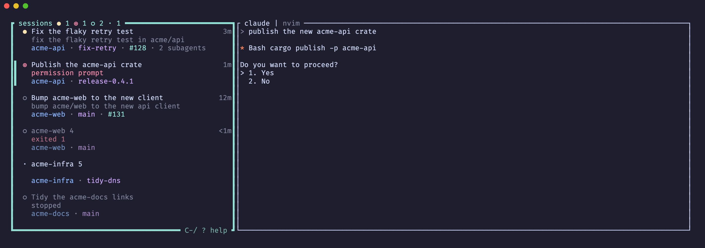

# harbour

Harbour: where shipping begins.



## Installation

```sh
brew install piacsek/tap/harbour
```

Or take a tarball from the [latest release](https://github.com/piacsek/harbour/releases/latest)
(macOS arm64 and x86_64, Linux x86_64; each has a `.sha256` and a build-provenance
attestation), or build the newest release from source with Rust 1.98+:

```sh
cargo install --git https://github.com/piacsek/harbour --branch stable --locked
```

Or with Nix (Linux, Apple silicon), from the `stable` branch, which follows the newest release:

```sh
nix --extra-experimental-features 'nix-command flakes' profile install github:piacsek/harbour/stable
```

## Usage

```sh
harbour             # on a terminal: a sidebar of Claude Code sessions beside a live pane
harbour --demo      # the same with made-up acme sessions: no claude needed
harbour --version   # or -V, or version
harbour --help      # or -h, or help
harbour changelog   # what each release changed
harbour status      # blocked, working and idle counts for the tmux status line
harbour edit <file> # open the file in the editor of the session that holds it
harbour log         # the path of the newest log, kept while HARBOUR_LOG is set
harbour config      # the settings file's path and where each setting comes from
```

| Key | Action |
|---|---|
| `j/k` | select the next / previous session |
| `n` | pick a directory and start a session there |
| `C-l/Enter` | focus or resume; C-l in Claude Code: editor |
| `C-h` | focus the sidebar; from an editor, Claude Code |
| `C-1..C-9` | focus or resume that card; C-9 the last |
| `M-z` | zoom the session to the whole screen, or back |
| `M--/M-=` | narrow / widen the sidebar by 2 columns |
| `M-\` | side by side (120+ columns); M-{/M-} swap |
| `M-s` | jump to a session by part of its name |
| `e` | show the next editor, one per directory |
| `x` | end it and its editors, or forget an ended one |
| `u` | show Claude Code's usage and limits |
| `?` | show or hide the help |
| `q` | quit, after a yes while anything runs |

`n` picks the directory with fzf, from the directory harbour was opened in and the ones
zoxide ranks; `HARBOUR_DIR_PICKER` names another picker. Without fzf, sessions start in the
directory harbour was opened in. Sessions end when harbour quits. Inside tmux with
vim-tmux-navigator, add `harbour` to the pattern of processes it passes `C-h` and `C-l` to.

## Development

```sh
scripts/gates.sh          # scrub check, fmt, clippy, tests
scripts/dev-install.sh    # the working tree as ~/.local/bin/harbour-dev
scripts/ship.sh "message" # gates, dev-install, commit, push, draft PR
```

Guidelines live in `AGENTS.md`.
