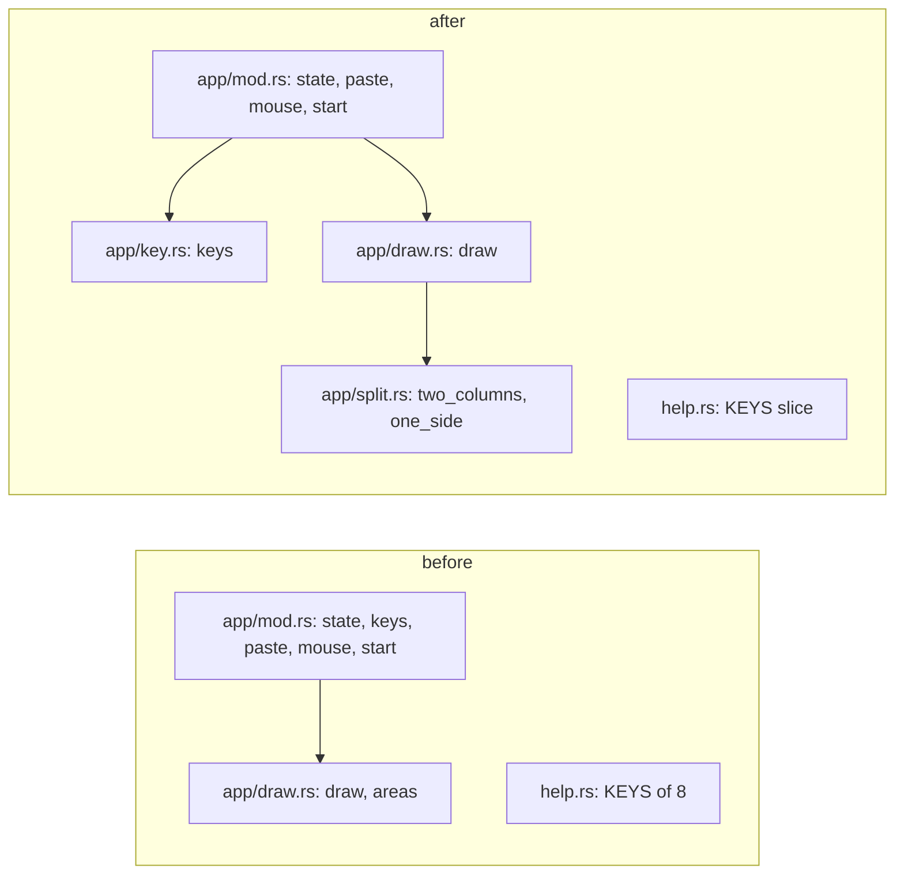

# Phase 15: room for the key and layout features

## Context

Issue #50. Several planned features add a key, change how the screen is split, or both (#30's
sidebar width, #36, #37, #39, #41, #42). Today each would edit the same few places, so two of
them built at once conflict, and the first to land is forced into a refactor of its own. This
phase moves code so that each of them adds a file and touches the shared ones with a line.
Code moves, behaviour does not: nothing a user can see or press changes. Phase 15 is a
multiple of 5, so it opens with the sweep of phases 11 to 14.

## Verified facts (2026-11-21, `main` at 3d5b265, macOS 25.5, Rust 1.98)

- `src/app/mod.rs` is 667 lines, against the 700-line limit of `tests/source_size.rs`. Its
  `key` and `key_handled` take every key; the sidebar keys call `focus_or_resume`, `quit`,
  `pick_or_start`, `end_or_remove` and `next_editor`, all private methods of `App` in that
  file, and `is_ctrl`, `is_yes` and `changes` are used only by them.
- `dismiss` and `answer_yes` are shared with `paste_handled` and `mouse_handled`, so they stay.
- `src/app/draw.rs` is 287 lines. `areas` is the one function that splits the terminal between
  the sidebar and the pane; `NARROW` (60) is used only there, though it is declared in
  `src/app/mod.rs`.
- `src/help.rs` declares `KEYS: [(&str, &str); 8]`; its readers (`draw_help` in
  `src/app/draw.rs`, `help_key_rows` in `tests/readme.rs`) only iterate it, so a slice needs no
  change in either.
- `use crate::keys` in `src/app/mod.rs` takes the name `keys` in the `app` module, so the new
  file cannot be `src/app/keys.rs` without renaming an import.
- A private method in an `impl App` of a child module of `app` is visible only in that child;
  what `src/app/mod.rs` or `src/app/draw.rs` calls is `pub(super)`, as in
  `src/app/remember.rs`. `tests/dead_code.rs` scans `pub` items under `src/`, so each new
  `pub(super)` item needs a caller elsewhere in `src/`, which a move keeps.

## What moves where

| From | To | What |
| --- | --- | --- |
| `src/app/mod.rs` | `src/app/key.rs` | `key`, `key_handled` (one line per sidebar key), `focus_or_resume`, `next_editor`, `end_or_remove`, `quit`, `pick_or_start`, `changes`, `is_ctrl`, `is_yes` |
| `src/app/draw.rs`, `src/app/mod.rs` | `src/app/split.rs` | `areas`, now one function per decision: `two_columns` from 60 columns, `one_side` below, and `NARROW` |
| `src/help.rs` | `src/help.rs` | `KEYS` becomes a slice, `&[(&str, &str)]` |

No new behaviour, so no state table: nothing here reads from outside harbour or draws new text.

## Tasks

1. The sweep, this plan, its `PLAN.md` and `plans/metrics.md` rows, and the after-merge cells
   of phase 14. No `src/` change.
2. Keys move to `src/app/key.rs`, with the fragment `changes/phase-15-room-for-keys-and-layout.md`
   (`kind: internal`, no bullet) and the `AGENTS.md` layout line.
3. The split moves to `src/app/split.rs`, with its layout line.
4. `KEYS` becomes a slice.
5. Screenshots rerun and compared byte for byte; `## Outcome` and `## Hurdles`.

TDD for a pure move: there is no new behaviour to see red. Each move runs the tests that cover
it before and after (the `app` target for keys and the split, `readme` and the help view for
`KEYS`), and every existing test passes unchanged; a test that has to change means behaviour
moved, and the phase stops. For `KEYS`, the red run is the compile error a ninth row gives the
old array.

## Outcome

### Sweep

Range: phases 11 to 14, read from `scripts/sweep-report.sh` (which starts after phase 10, the
last `### Sweep`) and each plan's `## Outcome` and `## Hurdles`; all four are on `main`. The
owner decided the hurdles of phases 11 to 13 on 2026-11-20 with the phase 10 sweep ("Decided
2026-11-20" in `plans/phase-10-resumable-sessions.md`), so they are not proposed again; this
sweep judges phase 14's and what phase 14 repeats. The report counted 28 hurdles: `test-seam`
10, `review-loop` 6, `ci` 3, `design` 3, `process` 3, `tooling` 3; seven went `→ none`. The
owner was away and decided in advance that every finding becomes a proposed issue, no rule
and no backlog line is applied, and nobody is asked.

- The help view has no rows to spare: phase 14's seventh note pushed it past 20 rows and two
  notes were merged (phase 14), phases 10 and 11 had to keep it inside 80x24, and five queued
  features (#36, #37, #39, #41, #42) each add a key row → issue.
- Process rules held only in prose broke three times, each `→ none`: production code before its
  red run (phase 12), a reviewer in the branch's worktree (phase 13), a builder handing back
  while another worktree's gates ran (phase 14). The phase 14 one is the only one a script can
  enforce, and its cause, tests losing timing races beside another ship's load, is the class of
  issue #47 → issue.
- A test passed without exercising what it named (phase 14's contained panic), a repeat of the
  phase 5 and phase 10 finding; the rule taken then ("a green first run is not red") held, and
  the red run was shown → declined, the rule worked.
- A fixture collided with the build machine's live state (phase 14: log `4100.log` named a live
  pid), as the checkout's folder name (phases 2, 6, 8) and the real fzf (phase 4) did before →
  declined: each case was fixed in code or guarded by its own test, and no general check can
  know which values are live.
- The app's log bookkeeping runs with the log off and needs a seam to test (phase 14) →
  declined: already a `PLAN.md` backlog line.

Metrics (from `plans/metrics.md`): review rounds 2, 5, 2, 2 for phases 11 to 14; start to end
1 h 35 min (phase 11, release), 5 h 14 min (phase 12, release), 27 min (phase 13, merge, no
release), 1 h 37 min (phase 14, release, read from GitHub in this phase). Claude reviewer tokens
per round stay between 84k and 159k (phase 14: 158525 then 83561); builder notices per phase 5,
14, 4 and 5 (phase 14's last ship unknown). The orchestrator's context grew by 52839, 103156,
22195 and 94321 over phases 11 to 14, but phases 11 and 12 shared one session with every phase before them,
phase 13 ran a review coordinator and phase 14's session carried four other pull requests, so
no two rows compare and no trend can be read. Process drift: none; every phase had a worktree,
a review and a metrics row.

## Hurdles
